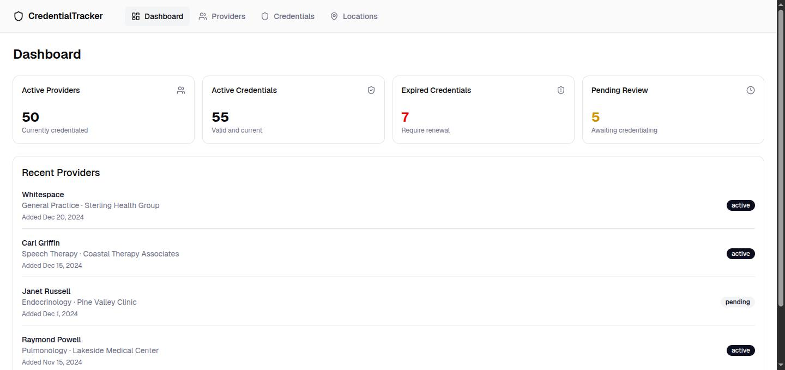
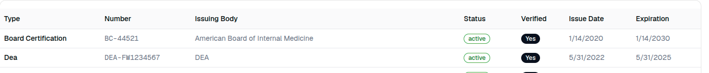
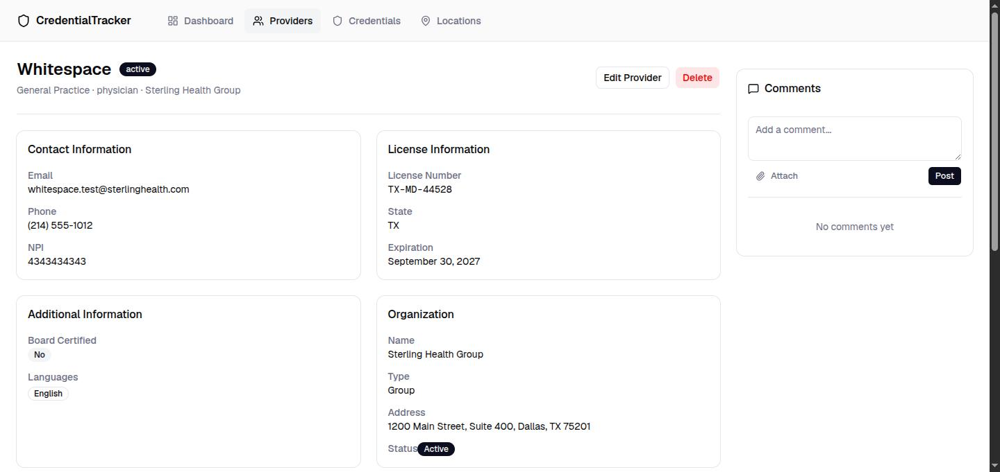
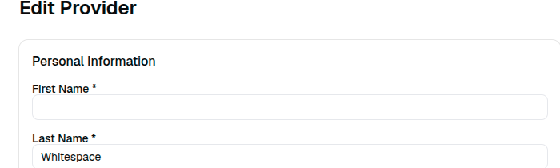

# CredentialTracker QA Report

- **Author:** Micaela Jara
- **Date:** 2026-08-05
- **Environment tested:** `$APP` (the application URL provided), cross-checked against `$DOCS_APP` (the base URL listed in the API documentation) and the read-only PostgreSQL database provided for this challenge.
- **Publishing note:** the real URLs are replaced with `$APP` and `$DOCS_APP` so this report doesn't hand the challenge to the next candidate. All data in the environment is synthetic.

**Summary:** Two Critical findings drive this report. `GET /api/providers` returns date of birth and internal HR/legal notes (malpractice claims, background checks) to anyone, no login required (finding 1), and the Dashboard's own headline metrics understate real credential expirations by more than half, the exact thing this product exists to catch (finding 2). Three High findings follow: an unauthenticated SQL injection point on `sortField` (3), an API that returns HTTP 200 regardless of actual outcome (4), and credential dates that render a day off in the one screen meant to track compliance (5). Three Medium findings round it out, covering input validation, a data-integrity gap in a required field, and a shared, non-isolated test environment. Severity throughout is ranked by real-world consequence, not by technical novelty, full steps, evidence, and reasoning for each are below.

*Data notice: everything in this environment is synthetic, no real patient or provider information is present. Every finding below is still rated as if it were a production system handling real records, that's what the severity language throughout (malpractice claims, DEA registrations, patient safety, compliance dates) is doing on purpose, not for effect.*

---

## Application overview

Before testing anything, I spent time understanding what CredentialTracker actually does, since a finding is only as good as the domain judgment behind its severity.

CredentialTracker is a healthcare credentialing system. Its job is to answer one question reliably for a group of clinics: is this provider currently allowed to practice, right now. That depends on a chain of records staying accurate at the same time, a valid state license, a current DEA registration if they prescribe controlled substances, an active malpractice policy, and in some cases a board certification, all of it tied to the organization and physical location where they actually work. That's why the data-integrity findings in this report (2, 5, 7) carry more real-world weight than they might in a simpler CRUD app: this is exactly the kind of system where "the status field says active but the date says expired" is not a cosmetic bug, it's the one thing the whole product exists to prevent.

The data model has five entities that matter: `organizations` (clinics and groups), `providers` (the people, linked to one organization), `credentials` (licenses, DEA, board certs, malpractice, linked to a provider), `locations` (physical sites, linked to providers through a many-to-many `provider_locations` table since one provider can work across several sites), and `documents`/`comments` (supporting files and notes attached to a provider). Understanding those relationships before testing is what made the JOIN in Finding 2 (providers marked active under an inactive organization) findable at all; without knowing that `organization.is_active` was supposed to mean something to the provider's own status, that inconsistency would have looked like two unrelated facts.

The UI has four screens, reached from the same top navigation on every page:

- **Dashboard**, the landing page: four summary tiles (Active Providers, Active Credentials, Expired Credentials, Pending Review) and a "Recent Providers" list. This is the page most likely to be someone's daily glance at the system, which is exactly why Finding 2 living here matters.
- **Providers**, a searchable, sortable, filterable table with an "Add Provider" action and a CSV export. Each row opens a detail page with the provider's contact and license info, a Comments panel, and Locations/Credentials/Documents sub-sections, plus an Edit form.
- **Credentials**, a flat table across all providers, filterable by type and status, which is where Finding 5 (the off-by-one dates) is visible.
- **Locations**, a table of physical clinic sites with address and active/inactive status.

One thing about the interface that's worth stating plainly because it shapes how I read every other finding: there is no login screen anywhere. No account creation, no sign-in, nothing gating any of the four pages or the API behind them. I noticed that within the first few minutes of navigating the app, before I ever queried the API, and it's the lens I tested everything else through afterward: if there's no authentication layer at all, then anything the API sends is effectively public, whether or not the UI chooses to display it.

---

## 1. Findings

Eight findings, ranked by severity, highest first. Between them they cover all three layers this challenge asked for, not just one: findings 5 and 7 live in the UI, findings 1, 3, 4, 6, and 8 in the API layer, and findings 2, 7, and 8 in the data itself, where a status field has drifted out of sync with the row it's supposed to describe. The defect types are mixed too, security (1, 3), data integrity (2, 6, 7, 8), and functional or behavioral (4, 5), rather than all of one kind.

### Finding 1: Exposes date of birth and internal notes with no authentication

**Environment:** `GET /api/providers`, `GET /api/providers/:id`

**Severity:** Critical. `internal_notes` holds malpractice claim numbers, background check results, HR directives, and compensation terms. `date_of_birth` is PII. Both are reachable by anyone, with no login, API key, or cookie of any kind.

**Steps to reproduce:**

1. `curl -s "$APP/api/providers/b0000000-0000-0000-0000-000000000004"`, no auth headers.
2. Open the same provider's page in a browser and compare what renders on screen against the raw response.

**Actual result:** The API response includes `date_of_birth` and `internal_notes` in full. The rendered page shows Name, Status, Specialty, Organization, contact info, license info, and a public "Notes" field, and nothing else. Neither `internal_notes` nor `date_of_birth` ever appears on screen.

**Expected result:** A field the product deliberately hides from every screen should either not be in the API response at all, or should require authentication before it's returned.

**Evidence:**
```
$ curl -s "$APP/api/providers/b0000000-0000-0000-0000-000000000004"
{
  "data": {
    "first_name": "Emily", "last_name": "Rodriguez", "status": "inactive",
    "date_of_birth": "1976-09-30T00:00:00.000Z",
    "notes": "On leave",
    "internal_notes": "FMLA leave since 2025-06. Malpractice claim #MC-2024-0892 pending, do not reassign patients."
  }
}
```
The same two fields show up on every record returned by `GET /api/providers`, not just this one.

*Tested by calling the live API directly with curl, no auth headers, then comparing that response against what the same provider's page actually renders in the browser.*

---

### Finding 2: Understates active provider and credential counts on the Dashboard

**Environment:** Dashboard (`/`), backed by `GET /api/providers` and `GET /api/credentials`; `providers` and `credentials` tables.

**Severity:** Critical. The whole point of these two numbers is to flag lapsed licenses and DEA registrations before someone keeps practicing under them. Undercounting real expirations by more than half defeats that purpose.

**Steps to reproduce:**

1. `SELECT status, count(*) FROM credentials GROUP BY status;`
2. `SELECT count(*) FROM credentials WHERE expiration_date < CURRENT_DATE;`
3. Open the Dashboard and read the "Expired Credentials" and "Active Providers" tiles.
4. `SELECT status, count(*) FROM providers GROUP BY status;`

**Actual result:** "Expired Credentials" shows 7, matching the count of rows where `status` is literally `'expired'`. A direct count of credentials whose `expiration_date` has actually passed returns 15; the other 8 are still marked `active` and get counted inside the healthy-looking "Active Credentials: 55" tile instead. Separately, "Active Providers" shows 50, which is the total row count in `providers`, not the 40 rows where `status` actually equals `'active'`.

**Expected result:** "Expired Credentials" should reflect credentials whose `expiration_date` has passed, or at minimum stay in sync with that date. "Active Providers" should count only providers with `status = 'active'`.

**Evidence:** (`$DB` below is the read-only PostgreSQL connection string provided for this challenge)
```
$ psql "$DB" -c "SELECT status, count(*) FROM credentials GROUP BY status;"
 active: 55, pending: 7, expired: 7

$ psql "$DB" -c "SELECT count(*) FROM credentials WHERE expiration_date < CURRENT_DATE;"
 15

$ psql "$DB" -c "SELECT credential_type, credential_number, status, expiration_date FROM credentials WHERE status = 'active' AND expiration_date < CURRENT_DATE;"
 dea         | DEA-FW1234567 | active | 2025-06-01
 malpractice | MAL-001-2024  | active | 2025-01-01
 dea         | DEA-JO9876543 | active | 2026-01-01
 dea         | DEA-SA5551234 | active | 2026-03-01
 dea         | DEA-CL3334444 | active | 2026-05-01
 dea         | DEA-LY7778888 | active | 2026-06-01
 malpractice | MAL-CO-002    | active | 2025-01-01
 dea         | DEA-CS4445555 | active | 2026-04-01

$ psql "$DB" -c "SELECT status, count(*) FROM providers GROUP BY status;"
 inactive: 5, active: 40, pending: 5

$ psql "$DB" -c "SELECT p.first_name, p.last_name, p.status AS provider_status, o.name AS org_name, o.is_active AS org_active FROM providers p JOIN organizations o ON p.organization_id = o.id WHERE o.is_active = false AND p.status = 'active';"
 Edward   | Brooks | active | Mountain View Rehabilitation | f
 Helen    | Reed   | active | Mountain View Rehabilitation | f
 Virginia | Morgan | active | Mountain View Rehabilitation | f
 Arthur   | Bell   | active | Mountain View Rehabilitation | f
```



Related: the last query above shows four of the 40 providers actually marked active belong to "Mountain View Rehabilitation," an organization whose own `is_active` flag is `false`. Same root cause, a status field nobody keeps in sync with the state it's supposed to reflect.

*Tested by comparing the dashboard's own displayed numbers against a direct SQL count run on the same data, instead of trusting either source on its own.*

---

### Finding 3: Leaks raw SQL through the unsanitized `sortField` parameter

**Environment:** `GET /api/providers`, `sortField` query parameter.

**Severity:** High. An unauthenticated parameter reaches the database query builder directly enough to produce a raw Postgres error. That's an unauthenticated SQL injection point. Per the rules of engagement ("confirm the exposure, do not extend it") I stopped at confirming it and did not attempt to extract data through it.

**Steps to reproduce:**

1. `curl "$APP/api/providers?sortField=last_name;DROP"`

**Actual result:** The response body contains a raw Postgres syntax error, referencing `ASC`, which only ever appears inside a dynamically built `ORDER BY` clause. That confirms `sortField` is concatenated directly into the query rather than checked against the whitelist or bound as a parameter.

**Expected result:** `sortField` is documented as a fixed whitelist (`last_name`, `created_at`, `status`, `specialty`, `email`, `npi`, `organization_name`). Any other value should be rejected cleanly, not passed through to the database.

**Evidence:**
```
$ curl -s "$APP/api/providers?sortField=last_name;DROP"
{"data":[],"count":0,"error":"syntax error at or near \"ASC\""}
```

*Tested by sending a value outside the documented whitelist to `sortField` with curl and reading the raw error that came back; stopped there per the rules of engagement rather than trying to go further.*

---

### Finding 4: Returns HTTP 200 regardless of actual outcome

**Environment:** All tested endpoints, confirmed on `GET /api/providers/:id`, `POST /api/providers`, and the malformed query from Finding 3.

**Severity:** High. Any client that checks the HTTP status code to detect failure, the normal way to consume a REST API, will read every one of these failures as a success. Directly contradicts the shipped documentation.

**Steps to reproduce:**

1. `curl -s -o /dev/null -w "%{http_code}" "$APP/api/providers/00000000-0000-0000-0000-000000000000"`
2. `curl -s -o /dev/null -w "%{http_code}" -X POST "$APP/api/providers" -d '{}'`

**Actual result:** Both requests return HTTP 200. The first has a body of `{"data":null,"error":"Provider not found"}`, the second `{"success":false,"error":"First name, last name, and email are required"}`. The malformed-query case from Finding 3 also returns 200.

**Expected result:** The documentation defines 404 for a missing record and 400 for a validation error. The status code should match.

**Evidence:**
```
$ curl -s -o /dev/null -w "%{http_code}" "$APP/api/providers/00000000-0000-0000-0000-000000000000"
200   body: {"data":null,"error":"Provider not found"}

$ curl -s -o /dev/null -w "%{http_code}" -X POST "$APP/api/providers" -d '{}'
200   body: {"success":false,"error":"First name, last name, and email are required"}
```

*Tested by checking the actual HTTP status code with `curl -w`, on purpose, since reading only the JSON body would have hidden the mismatch.*

---

### Finding 5: Renders credential dates one day earlier than stored

**Environment:** UI, Credentials list (`/credentials`); data comes from `GET /api/credentials`.

**Severity:** High. This is a system built specifically to track legal and compliance expiration dates. Showing the wrong calendar day means whether a credential reads as valid or already lapsed on a given day depends on where the person viewing the screen happens to be.

**Steps to reproduce:**

1. `curl "$APP/api/credentials?"` and note `issue_date`/`expiration_date` for the first row.
2. Open `/credentials` in a browser and compare the same row's displayed dates.

**Actual result:** Credential `BC-44521` has `issue_date: "2020-01-15"` and `expiration_date: "2030-01-15"` in the API, but the UI shows `1/14/2020` and `1/14/2030`. Every other row follows the same one-day-earlier pattern, for example `DEA-FW1234567` is `2022-06-01`/`2025-06-01` in the API and `5/31/2022`/`5/31/2025` on screen.

**Expected result:** These are date-only values stored as midnight UTC. The UI should display the same calendar date the API returns, regardless of the viewer's local timezone.

**Evidence:**



*Tested by opening the live Credentials page in a real browser and comparing what it rendered against the raw JSON the API returned for the same rows.*

---

### Finding 6: Accepts invalid email, NPI, and status on provider creation

**Environment:** `POST /api/providers`

**Severity:** Medium. `status` drives dashboard metrics and filters throughout the app, NPI is a regulated 10-digit healthcare identifier, and email exists to notify someone. All three are accepted with garbage values.

**Steps to reproduce:**

```
curl -X POST "$APP/api/providers" -d '{
  "organization_id": "a0000000-0000-0000-0000-000000000001",
  "first_name": "QA", "last_name": "TestRecord",
  "email": "not-an-email-format", "npi": "ABCDEFGHIJ",
  "status": "totally-invalid-status"
}'
```

**Actual result:** The record is created successfully with all three invalid values stored as-is. `internal_notes` sent in the same request was not persisted, so mass assignment is at least blocked on that one field; this is purely a validation gap.

**Expected result:** Rejection (400) for a malformed email, a non-numeric NPI, and a `status` outside the documented enum (`active`, `inactive`, `pending`). The edit form's own Status field is a dropdown offering only those three values, so the product clearly intends this to be a closed set; that restriction only lives in the UI.

**Evidence:**
```
{"success":true,"data":{"email":"not-an-email-format","npi":"ABCDEFGHIJ","status":"totally-invalid-status", ...}}
```
The test record was deleted right after confirming the response.

*Tested with a real POST request carrying deliberately malformed values, then deleted the resulting record immediately after confirming the response, so no bad data was left behind.*

---

### Finding 7: Accepts a whitespace-only value in a required field

**Environment:** UI, Dashboard "Recent Providers" list and Provider Detail/Edit pages (`/providers/b0000000-0000-0000-0000-000000000050`); API, `GET /api/providers?search=Whitespace`.

**Severity:** Medium. A provider record with no usable name breaks search and identification in a system where getting the right person's credentials right is the entire point. The record's own `internal_notes` reads "Test record, whitespace in first_name field. Entered by admin during data migration," which reads like the challenge authors flagging their own seeded bug, so this may well be intentional, planted or not it's still a real defect.

**Steps to reproduce:**

1. Open the Dashboard: the top "Recent Providers" entry displays as "Whitespace," with no first name.
2. Open that provider's detail page: the header shows only "Whitespace."
3. Click "Edit Provider": the "First Name *" field, marked required, renders empty.
4. `curl "$APP/api/providers?search=Whitespace"`.

**Actual result:** `first_name` holds `"  "`, two literal space characters, not null and not an empty string. The value passes as "present" and is stored and displayed everywhere as if it were a real name.

**Expected result:** A required field should reject whitespace-only input, both client-side and server-side, since it carries no usable identifying information.

**Evidence:**
```
$ curl -s "$APP/api/providers?search=Whitespace"
{"data":[{"id":"b0000000-0000-0000-0000-000000000050","first_name":"  ","last_name":"Whitespace", ...}]}
```





*Tested by clicking through the Dashboard and the edit form in a real browser first, then confirming the exact stored value with a direct API call once the UI made me suspicious.*

---

### Finding 8: Shares one database across two deployments with no isolation

**Environment:** `$DOCS_APP` (API documentation's base URL) and `$APP` (the assigned application URL); `providers` and `organizations` tables.

**Severity:** Medium. Test data is not isolated between environments or between whoever else might be testing at the same time, and reproduction steps captured at one point in time may not hold later.

**Steps to reproduce:**

```
curl -s "$DOCS_APP/api/providers?pageSize=200" | python3 -c "import json,sys; print(len(json.load(sys.stdin)['data']))"
curl -s "$APP/api/providers?pageSize=200" | python3 -c "import json,sys; print(len(json.load(sys.stdin)['data']))"
```

**Actual result:** `DOCS_APP` returns 51 providers against `APP`'s 50. The extra record on `DOCS_APP` carries a random UUID instead of the seeded sequential pattern every other provider uses, consistent with leftover test data from another session. The same provider ID queried on both URLs seconds apart returned different `additional_info` content and different `updated_at` values. Every row across the whole `providers` table, and the linked `organizations` row, shared the exact same `updated_at` timestamp during this session, which points to the entire dataset getting reset periodically.

**Expected result:** Either a single documented environment, or clearly separated staging/production data. Two URLs silently sharing one mutable, apparently auto-resetting database is not documented anywhere.

**Evidence:**
```
$ curl -s "$DOCS_APP/api/providers?pageSize=200" | python3 -c "import json,sys; print(len(json.load(sys.stdin)['data']))"
51
$ curl -s "$APP/api/providers?pageSize=200" | python3 -c "import json,sys; print(len(json.load(sys.stdin)['data']))"
50

$ curl -s "$DOCS_APP/api/providers?pageSize=200" | python3 -c "import json,sys; [print(p['id']) for p in json.load(sys.stdin)['data']]" | sort > docs_app_ids.txt
$ curl -s "$APP/api/providers?pageSize=200" | python3 -c "import json,sys; [print(p['id']) for p in json.load(sys.stdin)['data']]" | sort > app_ids.txt
$ diff docs_app_ids.txt app_ids.txt
51d50
< f57a5d3a-bade-4a79-8fee-711765cb5768
# DOCS_APP's one extra row: a random UUID, not the seeded b0000000-...-000N pattern every other provider uses

$ curl -s "$DOCS_APP/api/providers/b0000000-0000-0000-0000-000000000021" | python3 -c "import json,sys; d=json.load(sys.stdin)['data']; print(d['additional_info'], d['updated_at'])"
{} 2026-08-04T23:27:39.870Z
$ curl -s "$APP/api/providers/b0000000-0000-0000-0000-000000000021" | python3 -c "import json,sys; d=json.load(sys.stdin)['data']; print(d['additional_info'], d['updated_at'])"
{'languages': ['English'], 'board_certified': True} 2026-08-05T15:55:23.595Z
# same provider ID, two different additional_info payloads and two different updated_at values, depending only on which URL answers

$ psql "$DB" -c "SELECT count(DISTINCT updated_at) AS distinct_values, count(*) AS total_rows FROM providers;"
 distinct_values | total_rows
------------------+------------
                1 |         50
$ psql "$DB" -c "SELECT DISTINCT updated_at FROM providers;"
 2026-08-05 15:55:23.595047+00
# all 50 rows in the providers table share one identical updated_at value, consistent with a bulk reset rather than 50 independent edits
```

To rule out this being a one-table fluke, I checked whether the split was systemic or isolated. `credentials` (69), `organizations` (5), and `locations` (12) return identical counts on both URLs; only `providers` diverges, by exactly the one stray record. I also reran findings 2, 3, 4, and 7 directly against `DOCS_APP`: the same SQL error on the `sortField` probe, the same HTTP 200 on a not-found request, the same whitespace-only provider, and the same 40-vs-51 active-provider mismatch on its own Dashboard (`DOCS_APP` shows "Active Providers: 51," one more than `APP`'s 50, tracking the stray record). Both deployments run the same application against the same data and have the same defects; the divergence is limited to that single leftover row in `providers`.

*Tested by pulling the full provider list from both URLs and diffing the two, then rechecking table counts and re-running four other findings against `DOCS_APP` directly to confirm the two environments behave identically rather than assuming it from one table.*

---

## 2. Uncertainties

I couldn't tell from black-box testing whether `DOCS_APP` and `APP` are meant to be a staging/production pair, two parallel preview deployments of the same project, or just documentation that never got updated after a redeploy. I'd ask the team which one is authoritative before treating finding 8 as a real isolation problem rather than expected preview behavior.

The periodic reset I inferred from every row sharing one `updated_at` timestamp is a guess about a mechanism I can't actually see. If it runs often, some of the evidence above, the stray record on `DOCS_APP` especially, may already be gone by the time this is read.

I confirmed `sortField` reaches raw SQL but deliberately didn't check whether the same pattern shows up on `search`, `status`, or other filter parameters, or whether it goes beyond error-based disclosure into something actually exploitable. I'd want sign-off before probing further there.

The documentation's example payloads never mention `internal_notes` or `date_of_birth` at all. I can't tell from outside whether those fields were supposed to be excluded from the response and the scoping step is just missing, or whether authentication was always meant to come later and the API is unscoped on purpose for now. Either way it's still critical, but the fix looks different depending on which one it is.

I also don't know whether the Whitespace record and the dashboard metric mismatch are deliberately planted or genuine oversights. The internal note on the Whitespace record calling itself a test record points toward intentional, but I'd rather ask than assume.

Two smaller things that didn't make the top 8 but are worth mentioning. Searching a provider's full name exactly as shown on screen, "Arthur Bell" for example, returns nothing, while "Arthur" or "Bell" alone both work; the search seems to match each field independently rather than a concatenated full name, and that's the first thing a real user would try. And the Providers list has a "Verified" column that doesn't map cleanly to any single documented field: a provider with zero credentials on file, like Arthur Bell, still shows "Pending" instead of something closer to "no data," which could read either way depending on what the badge is meant to say.

---

## 3. Approach

**Prioritization.** Before any of that I spent time on open-ended exploratory testing of the product itself, clicking through every screen with no fixed script, because you can't judge whether a data-integrity bug is Critical or Low without actually understanding what the product is for and who relies on it being right. That's also why this report opens with an Application overview instead of jumping straight to a list of defects, it's not a template default, it's the same principle: severity judgment is only as good as the domain understanding behind it.

Once that groundwork was there, I moved into testing in layers, fastest and most direct signal first, and only moving to a slower manual pass once there's something concrete worth chasing. A database query or a curl request confirms or rules out a hypothesis in seconds; a full click-through in the browser takes longer and is better spent once I already know what I'm looking for. So the order here was database first, API second, UI last, each layer checking the one before it rather than being tested in isolation, and that's also just how I work day to day. It's where every finding in this report actually came from: finding 1 started as two undocumented columns in the `providers` table that the API returned in full and the UI never showed; finding 2 started as a hunch that the dashboard numbers looked too clean, confirmed with a direct count against the same tables. In every case the bug was in the disagreement between two layers, not visible from either layer alone.

**Severity.** I ranked by real-world consequence, not by how technically interesting a finding was to track down. The SQL injection (finding 3) is the more eye-catching one to explain, but I placed the PII exposure and the dashboard metrics above it, because those two are already live: no attacker has to go looking for anything, the API hands out malpractice claims and dates of birth to any request, and the dashboard is already telling whoever looks at it that a lapsed DEA registration is fine, today, with zero exploitation required. The injection is serious, but it's a door that's unlocked; the other two are already open.

**Evidence and ambiguity.** Every finding has a command or query that can be copy-pasted and rerun as-is, plus the actual response or a screenshot next to it, demonstrated rather than described. Where I couldn't independently confirm something, or the documentation and the live behavior disagreed and I couldn't tell which side was authoritative, it went into Uncertainties instead of getting stated as a finding or quietly folded into one to round out the number. I don't know, for instance, whether `internal_notes` and `date_of_birth` were meant to be excluded from the API response and the scoping step is simply missing, or whether authentication was always planned for later and everything is unscoped on purpose for now, both readings are plausible from outside, and I named both instead of picking whichever one sounded more confident. The clearest example of that discipline wasn't in a finding at all: the Comments panel looked stuck on "Loading" the first time I saw it, and it would have been an easy ninth defect to report. I checked the network tab instead of writing it up, it had just resolved slowly, about five seconds, and I left it out entirely. I'd rather under-report than pad the list with something I hadn't actually confirmed.

**Rules of engagement.** The database connection was read-only and I only ever ran `SELECT` queries against it. No load, stress, or volume testing against either deployment, every request in this report was a single, deliberate call. On the SQL injection point, I stopped as soon as the error confirmed the exposure and did not try to extract data through it. The one write I made anywhere was the test record for finding 6, created to reproduce that specific validation gap and deleted immediately after confirming the response; I also opened the seeded "Whitespace" record's edit form to inspect it, but closed it without saving.

**Tools.** `psql` with the read-only connection string, for real rows and aggregate counts before guessing at what the API or UI should show. `curl` against every documented endpoint, including boundary and invalid inputs and an injection probe on `sortField`, plus one controlled create-then-delete cycle so I could test validation without leaving test data behind. An interactive browser (Claude in Chrome) to walk through all four pages, open an edit form to check client-side constraints, and capture the screenshots used above.

**AI assistance.** I used Claude Code as a pairing partner, and I directed it the way I'd direct anyone helping me test: I set the priorities, database first, then API, then UI, the same layered method I already use on paid client work, and Claude executed under that direction, running the `psql` queries and `curl` requests, driving the browser, and cross-referencing responses against the documentation. But direction only matters if you check what comes back, and most of what's in this report exists because I pushed on something and it didn't hold up on the first pass. I rejected the first version of this write-up outright because the structure read generic and didn't match how I actually document a bug, and had it rebuilt around the field structure I use for real work. I asked directly whether we'd actually compared the two deployments thoroughly rather than assuming so, which is what produced the full cross-environment confirmation behind finding 8. I caught a header collapsing into a run-on line in the rendered PDF, a stale cached version the viewer kept showing after an update, and a broken command that got introduced while fixing something else, all by checking the actual output myself instead of taking "done" for an answer. And I went through this challenge's evaluation criteria one at a time against the finished draft, which is what surfaced the reproducibility gaps that got fixed before this version. Claude typed the commands. The standard this report had to clear was mine, and I'm the one who kept checking whether it did.

**Given more time**, I'd repeat the validation and mass-assignment checks against `credentials`, `documents`, `comments`, and `locations` (I only fully covered `providers` here), map whether the `sortField` injection pattern reaches other parameters without going past error-based confirmation, trace exactly how the "Verified" badge gets computed, and check whether the `file_url` values on Documents and Comments are guessable or otherwise reachable without authorization.
